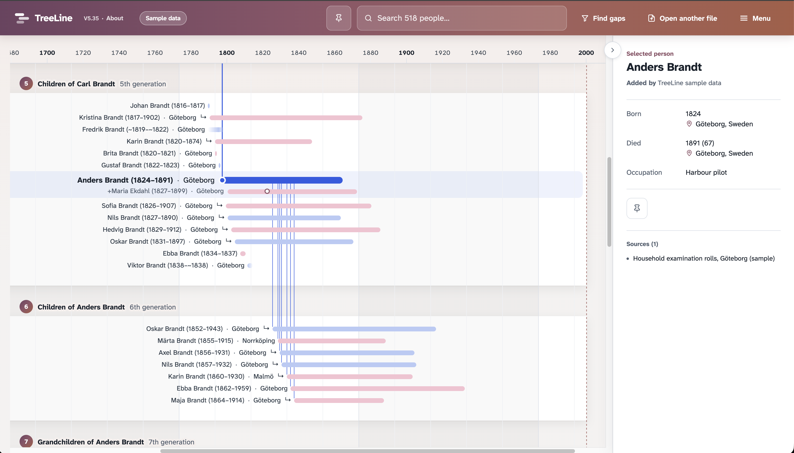

# TreeLine

TreeLine shows your family tree as a timeline.
Every person is a lifespan bar on one shared time axis.

**[▶ Open TreeLine](https://hseeberg.github.io/TreeLine/)** · [Download](https://github.com/hseeberg/TreeLine/blob/main/index.html)

You see:
- who lived at the same time
- how generations overlapped
- where data is missing (a research to-do list)

## Start

1. Open TreeLine.
2. Load the sample family, or your own GEDCOM file. GEDCOM (.ged) is the standard export format of Geni, MyHeritage, Ancestry and similar tools. The sample family is fictional. It contains no real persons.
3. Select a person. You see ancestors, siblings, partners and descendants.

## Why I built TreeLine?

Most genealogy tools show who is related to whom.
They do not show when people lived.

A classic tree chart hides that a grandfather and a
great-grandchild shared decades, or that siblings were
born across 50 years. TreeLine puts time first.

## Privacy

- Your GEDCOM file stays in your browser.
- No cookies. No analytics. No server processing.
- Photos linked in the file are never loaded.
- GitHub Pages may log visitor IP addresses.
  To avoid this, run TreeLine locally.

## Run locally

1. Download `index.html` from [Releases](https://github.com/hseeberg/TreeLine/blob/main/index.html).
2. Open it in your browser. No installation. No server.

## Details

- One HTML file
- Tested in: Google Chrome
- Current version: 5.31

## Feedback

Report bugs and ideas in [Issues](https://github.com/hseeberg/TreeLine/issues).
